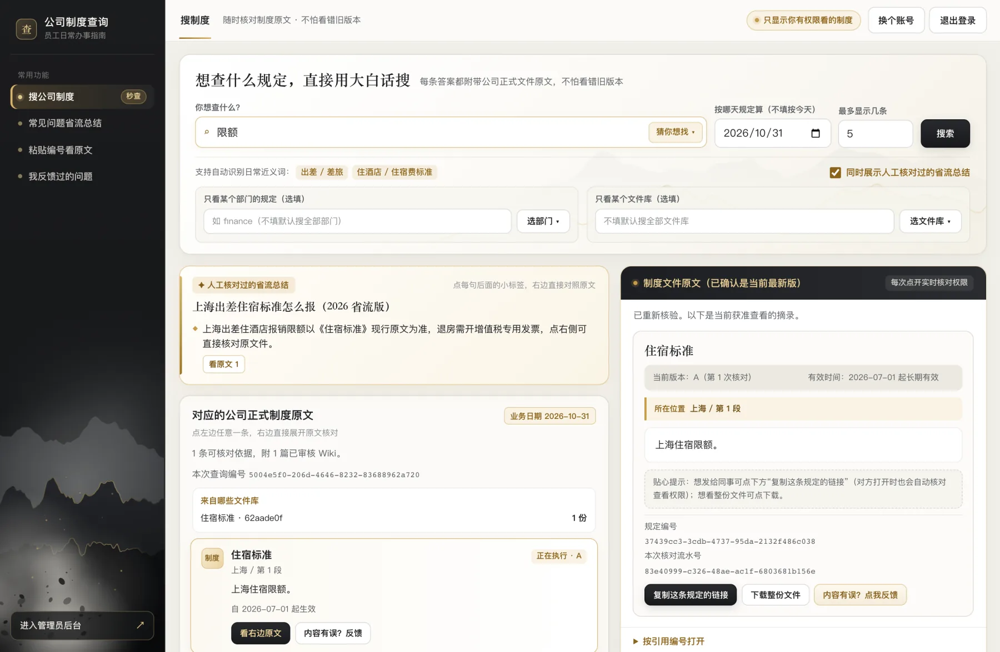
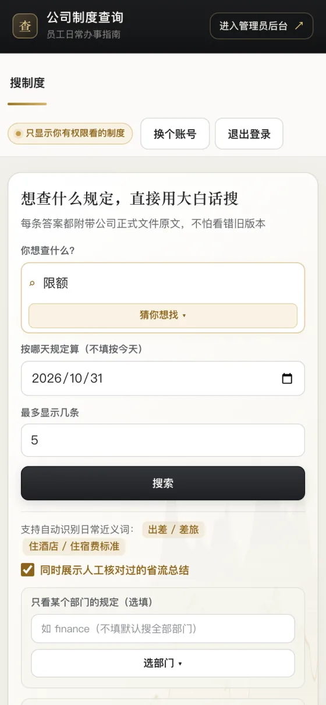
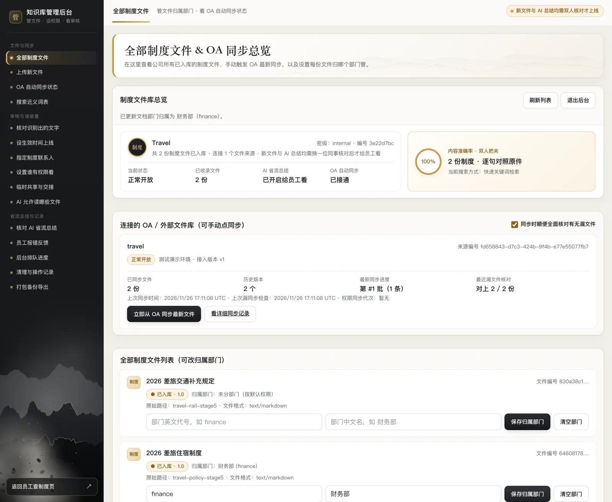
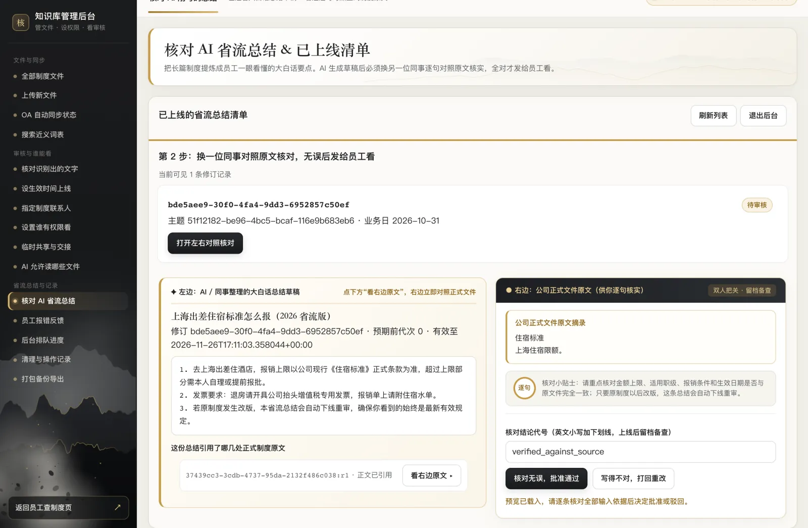
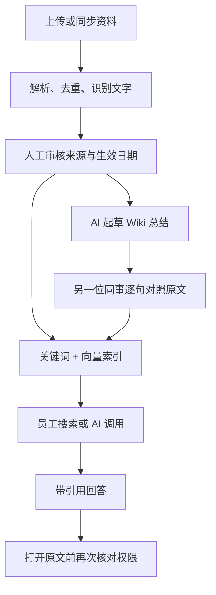

<p align="center">
  
</p>

<h1 align="center">Thalion 企业知识库</h1>

<p align="center">
  <b>查公司制度，不只看答案，还能回到原文。</b><br>
  员工用网页直接搜；企业把同一套检索能力接进已有的 AI 助手。
</p>

<p align="center">
  
  
  
  
  
  <a href="https://github.com/lorek666/Thalion-Enterprise-Knowledge-Base/actions/workflows/ci.yml">
    
  </a>
</p>

## 这是什么

很多公司把制度放在网盘、OA 或共享目录里。员工找得到文件，却不知道哪一份是现行版本；AI 给了答案，也不敢直接拿去报销。

Thalion 把这件事拆成两步：

- **先回答，再给出处。** 搜索同时用关键词和向量检索，答案要能落到具体文件、页码、段落或表格。
- **按「谁、什么时候」给结果。** 员工只看到自己有权查看的内容；按业务日期区分新旧规定；资料撤回或读权收回后，不再继续交付。

AI 可以帮忙整理 Wiki 总结，但不能自己发布。总结要由另一位同事逐句对照原文，核对通过后才给员工看。

## 界面预览

> 以下截图来自本地合成环境的真实页面，没有使用企业真实资料。

### 员工端：搜制度、看原文

输入「限额」这类大白话，系统会识别「出差 / 差旅」「住宿 / 住宿费标准」等近义词；结果按业务日期取适用版本，右侧直接展开公司正式文件原文。

<p align="center">
  
</p>

<p align="center">
  <sub>员工端：左边看答案，右边核对原文；打开和转发引用时都会重新检查权限。</sub>
</p>

### 手机端：在办事现场也能查

<p align="center">
  
</p>

### 管理端：资料从哪来、谁能看、是否该上线

管理员能看到每份文件归哪个部门、从哪个来源同步、当前是否对员工开放，以及最近一次同步有没有漏文件。

<p align="center">
  
</p>

### 管理端：AI 总结必须双人核对

左边是 AI 或同事整理的省流总结，右边是公司正式文件。核对人逐句对照后，才能批准上线；原文改版后，相关总结会自动下线重审。

<p align="center">
  
</p>

## 能做什么

| 你想做什么 | Thalion 现在能做什么 |
|---|---|
| 员工查制度 | 用大白话搜索；按部门、资料库、业务日期筛选；答案附带可点开的原文出处 |
| 核对答案 | 引用定位到文件、页码、段落或表格；打开或转发时按当前读者权限重新检查 |
| 分辨新旧规定 | 按业务日期取适用版本；新版没准备好时，不拿旧规定冒充现行答案 |
| 管理资料 | 批量导入 Markdown、PDF、DOCX、XLSX、PPTX、HTML 和图片；跟进入库、解析、审核、生效、撤回 |
| 同步企业来源 | 原生支持 Confluence Cloud、飞书知识库和 SharePoint 文档库；其他 OA 或自建系统使用通用 HTTPS 连接器 |
| 整理常见问题 | 把高频问题整理成 Wiki 主题页；AI 可起草，但必须换一位同事对照原文复核 |
| 接进现有系统 | 员工网页、HTTP API、MCP 共用同一套授权规则；支持企业 OIDC 登录 |
| 接模型和存储 | 支持 OpenAI 兼容的模型与向量接口；原件可放本地目录、S3、阿里云 OSS 或腾讯云 COS |
| 留痕和追责 | 记录请求、授权、发布、撤回和核对动作；支持备份、清理、打包导出和恢复检查 |

## 怎么用

**员工：** 打开公司给的地址，在搜索框输入问题。先看答案，再点右侧「看原文」核对；找不到足够依据时，系统会明确说找不到，而不是猜一个数字。

**管理员：** 从 `/manage/ingest` 上传或同步资料，跟进入库和解析状态；在审核页确认文字识别、生效日期和可查看范围；AI 总结由另一位同事复核后再上线。

**开发者：** 用 HTTP API 或 MCP 把检索能力接进现有 AI 助手。接口会返回 `request_id`、引用和权限检查结果，便于排查和审计。

## 快速试跑

先用**合成资料**体验，不需要连接企业账号、真实资料或付费模型。准备 `uv`、Python 3.14 和 PostgreSQL 18（含 pgvector）：

```bash
uv sync --locked --link-mode=copy
```

初始化数据库：

```bash
export THALION_DATABASE_URL="postgresql://thalion:<本地口令>@127.0.0.1:5432/thalion_synthetic"
uv run thalion-db upgrade
```

按[合成配置示例](deploy/synthetic-profile.example/README.md)准备私有配置目录，先做无副作用预检，再启动：

```bash
uv run thalion-serve --check-config \
  --profile /var/lib/thalion/profile \
  --originals /var/lib/thalion/originals \
  --port 8765

uv run thalion-serve \
  --profile /var/lib/thalion/profile \
  --originals /var/lib/thalion/originals \
  --port 8765
```

打开 `http://127.0.0.1:8765/` 进入员工门户；管理入口在 `/manage/*`，例如 `/manage/ingest`。

## 系统怎么工作



原文始终是最终依据。Wiki 总结只是省时间的入口；资料改版、撤回或读权变化时，相关总结会跟着失效或下线。

原生来源连接器按来源范围读取正文，页面或文件消失时先做漏项核对，不会直接确认删除。连接器不会把 Confluence、飞书或 SharePoint 的平台成员权限复制进知识库；员工最终能看到什么，仍以知识库的独立授权和撤权记录为准。

## 项目结构

项目采用 **Python 3.14、FastAPI、PostgreSQL 18 和 pgvector**。网页、HTTP 和 MCP 由同一应用提供，后台进程负责同步资料、解析和建索引。

```text
src/enterprise_kb/
├── transport/    员工门户、管理后台、HTTP API 和 MCP
├── modules/      来源、授权、取证、检索、Wiki 和知识治理
├── ports/        对接身份、对象存储、模型和其他外部服务
├── runtime/      配置、审计和后台任务
└── migrations/   应用共享数据库迁移
deploy/           Docker、Compose 和 systemd 部署示例
tests/            单元测试、数据库回归和可选浏览器测试
sql/              独立 SQL 原型与回归，不是应用数据库迁移
docs/             用户手册与界面截图
```

## 文档

| 文档 | 适合谁看 |
|---|---|
| [用户手册](docs/用户手册.md) | 员工怎么查制度，管理员怎么入库、授权、复核和发布 |
| [冻结盲测发布门禁](docs/发布门禁.md) | 发布人员如何冻结评估输入、汇总观测和判断是否放行 |

## 当前状态

> [!NOTE]
> 当前版本可以在隔离环境里用合成资料完整试跑，CI 覆盖 1000 多项回归。
>
> 正式上线前，仍要在目标环境验证真实来源、企业身份、模型网关、对象存储和异机恢复，并完成生产验收。仓库里的合成配置不是生产凭据，不能直接拿去上线。

## 许可证

本项目采用 [Apache License 2.0](LICENSE)。可以商用、修改和再分发，并附带专利授权；再分发时需要保留版权、许可和 [NOTICE](NOTICE) 声明，修改过的文件要注明改动。

## 参与开发

改动走正常的 GitHub 流程：开分支、提 PR、等 CI 通过后合并。不要跳过检查，也不要把真实令牌、员工资料或私有配置提交到仓库。

```bash
uv sync --locked --link-mode=copy
uv run pytest
```
