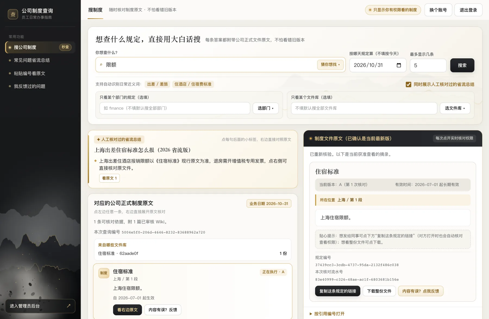
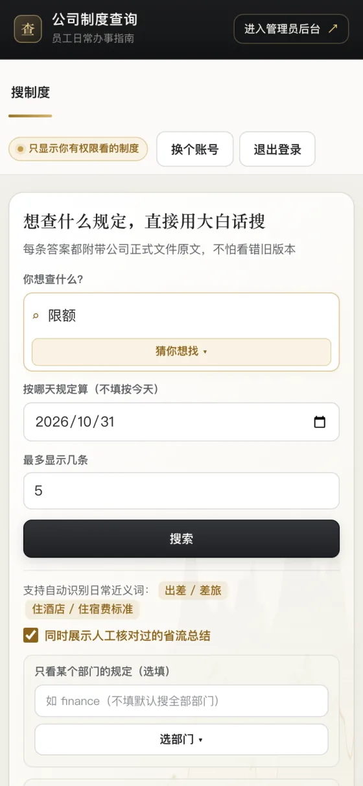
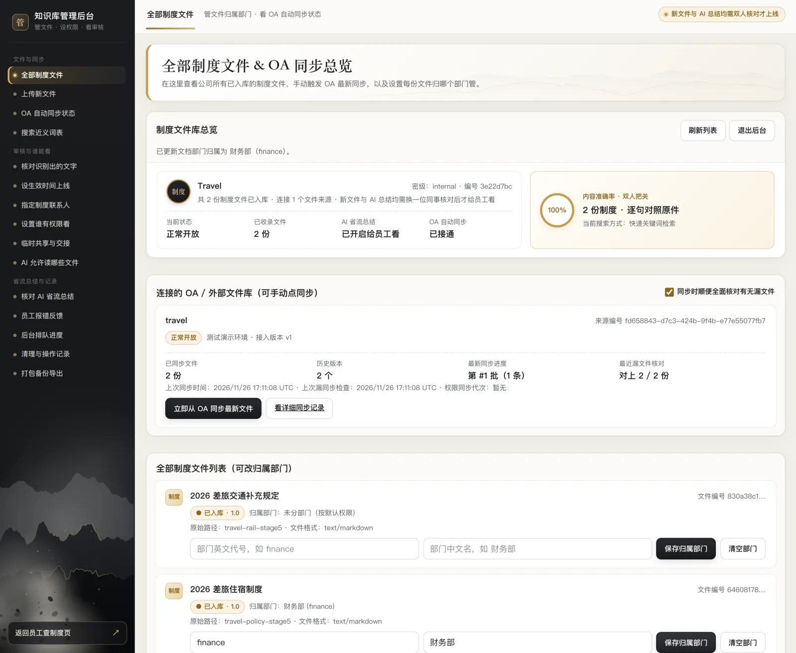
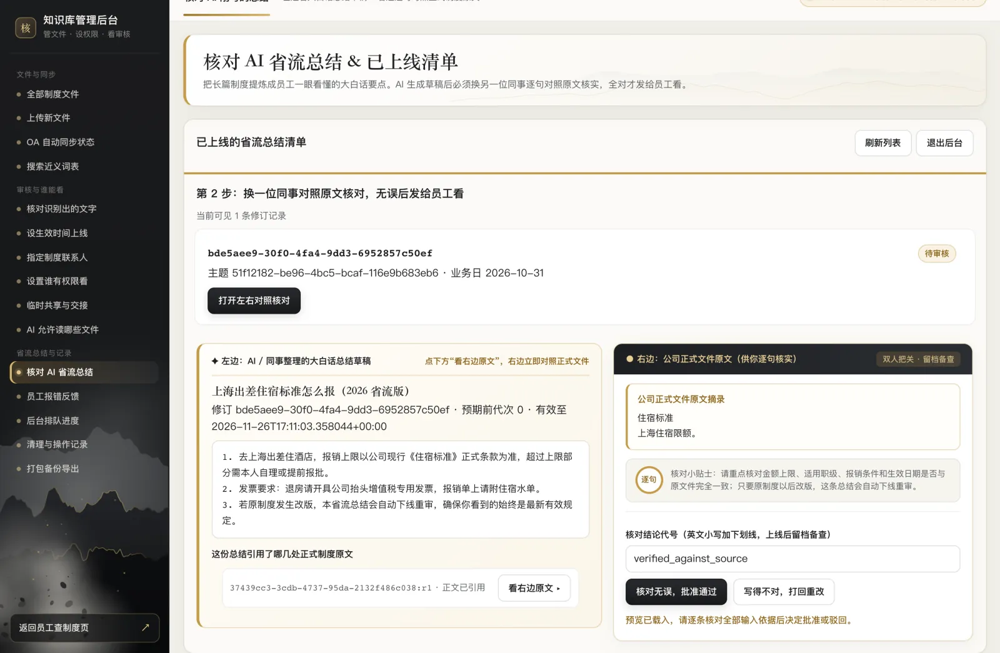

# Thalion 使用手册

这本手册只讲怎么用，不讲系统怎么开发。

> 截图来自本地合成环境，没有使用企业真实资料。

## 一、员工怎么查制度

### 1. 登录

打开公司给你的知识库地址。如果公司开启了企业单点登录，点「企业 SSO 登录」；否则用管理员发给你的账号登录。

登录后，你只会看到自己有权查看的制度。

如果提示「该企业账号没有知识库权限」，请让管理员核对你的账号和所在的企业群组。仅能登录企业账号，不代表已经开通知识库。员工在知识库里停用后，原来的登录也不能继续访问。

### 2. 直接搜问题

在搜索框里用大白话输入你想查的事，比如：

- 「上海出差住宿限额是多少？」
- 「报销需要哪些发票？」
- 「请假提前几天申请？」

系统会自动识别一些常见说法，例如「出差」和「差旅」、「住宿」和「住宿费标准」。

### 3. 选对日期和范围

如果你问的是某个时间点适用的规定，把「按哪天规定算」改成业务发生日期。

例如：员工在 2026 年 10 月出差，就选 2026-10-31，系统会按那一天生效的制度回答。

还可以只搜某个部门或某个资料库：

- 只看财务部的规定。
- 只看「差旅制度」这个资料库。

不选就默认搜全部你有权查看的范围。

### 4. 先看答案，再核对原文

搜索结果会分两块：

- 左边是直接回答，可能还有人工核对过的省流总结。
- 右边是公司正式文件原文。

点「看右边原文」，可以核对金额、适用范围、例外条件和生效日期。

### 5. 复制链接、下载和反馈

如果你要把规定发给同事，点「复制这条规定的链接」。对方打开时，系统会按他的权限重新检查。

需要整份文件时，点「下载整份文件」。没有下载按钮，说明你当前没有整件下载权限。

如果答案和原文对不上，点「内容有误？点我反馈」，写清楚哪里不对。反馈会进入管理员的纠错办理页面。

### 6. 手机上也能查

手机打开同一个地址即可。搜索、看原文、反馈都可以正常使用。

### 7. 搜不到怎么办

先试这三步：

1. 换一个更短的说法，比如把「上海出差住宿费能报多少」改成「住宿限额」。
2. 把业务日期改成实际发生日期。
3. 去掉部门或资料库筛选，看看是不是范围选窄了。

还是搜不到，说明系统没有找到足够依据。它不会为了给答案而猜一个数字。请联系制度负责人补充资料，或提交反馈。

## 二、管理员怎么把资料放进来

管理入口一般在 `/manage/` 下。你能看到哪些菜单，取决于你的角色和权限。

### 1. 上传新文件

进入「上传新文件」，选择文件并填写资料名称。

目前支持：

- Markdown
- PDF
- DOCX
- XLSX
- PPTX
- HTML
- 图片

上传后，文件会进入解析队列。解析完成后，先核对系统识别出的文字，再进入审核和发布。

### 2. 从 OA 或共享目录同步

进入「OA 自动同步状态」或「全部制度文件」，可以看到已经连接的外部来源。

已接通的来源可以手动同步。Confluence Cloud 目前同步页面正文，不同步附件或群组权限；页面消失时先报差异，不会当成已确认删除。其他来源可通过企业配置的通用连接器同步。同步后，仍要核对内容、生效时间和可见范围。

### 3. 核对识别出的文字

PDF、图片和扫描件可能识别错字。进入「核对识别出的文字」，重点检查：

- 金额、比例、日期
- 部门名称和人名
- 「可以」「不可以」「除外」这类关键字

识别不准的文件不要直接发布。

### 4. 设置生效时间和失效时间

进入「设生效时间上线」，填写这份规定从哪天开始适用，必要时填写失效日期。

员工按业务日期查询时，系统会取当天适用的版本。新版还没生效时，不会拿新版回答旧业务；新版生效后，也不会继续拿旧版冒充现行规定。

### 5. 设置谁能看

进入「设置谁有权限看」，按部门、空间或具体人员设置读者范围。

原则是：

- 只给工作需要的人看。
- 临时共享要写清楚截止时间。
- 人员调岗或离职后，及时收回权限。

### 6. 指定资料负责人

每份重要制度都应该有负责人。进入「指定制度联系人」，填写负责解释和维护这份制度的人。

员工反馈问题、原文改版或资料撤回时，系统会找到对应负责人处理。

### 7. 发布后检查

发布后，用员工账号实际搜一次，确认：

- 能搜到。
- 答案引用的原文正确。
- 生效日期正确。
- 没有权限的员工看不到。

## 三、AI 省流总结怎么复核

AI 可以把长制度整理成员工一眼能看懂的省流总结，但它不能自己发布。

### 1. 谁可以复核

起草人和复核人必须是两个人。起草人不能自己批准自己的总结。

### 2. 怎么复核

进入「核对 AI 省流总结」，左边是总结草稿，右边是公司正式文件。

逐句核对：

1. 金额、比例、日期是否一致。
2. 适用部门和岗位是否一致。
3. 「可以」「不可以」「例外」有没有写反。
4. 引用的原文是不是当前有效版本。

确认无误后，填写核对结论，点「核对无误，批准通过」。

发现问题就点「写得不对，打回重改」，并写清楚原因。

### 3. 原文改版后

原文改版、撤回或权限变化后，相关总结会自动下线重审。不要手工绕过这个流程。

## 四、常见问题

### 员工说搜不到

先确认他有没有查看权限，再确认业务日期和筛选范围。都没有问题，就让制度负责人检查资料是否已发布。

### 员工说答案和原文不一致

让员工点「内容有误？点我反馈」，附上问题和截图。管理员在「员工报错反馈」里处理，修好后可以让原提问人复测。

### 员工说看到的是旧版

检查新版是否已经生效、是否发布成功，以及员工选的业务日期是不是新版生效前的日期。

### 文件更新了，但搜索还是旧内容

确认解析和索引任务是否完成。进入「后台排队进度」查看是否还有积压。

### 员工离职或调岗

及时收回读者权限、临时共享和资料负责人身份。已经打开的旧链接会在下次访问时重新检查权限。

## 五、管理员常用页面

| 页面 | 用来做什么 |
|---|---|
| 全部制度文件 | 看所有文件、归属部门和同步状态 |
| 上传新文件 | 上传 Markdown、PDF、Office 文件、HTML 或图片 |
| OA 自动同步状态 | 查看外部来源，手动触发同步 |
| 核对识别出的文字 | 修正 PDF、图片和扫描件的识别错误 |
| 设生效时间上线 | 设置规定从哪天开始适用 |
| 指定制度联系人 | 给每份制度指定负责人 |
| 设置谁有权限看 | 设置部门、空间和人员权限 |
| 核对 AI 省流总结 | 双人对照原文复核 AI 总结 |
| 员工报错反馈 | 处理员工提交的纠错和疑问 |
| 后台排队进度 | 查看解析、索引等后台任务 |
| 打包备份导出 | 申请空间归档和备份包检查 |

## 六、遇到问题找谁

- 制度内容不对：找「指定制度联系人」里的负责人。
- 搜不到或权限不对：找知识库管理员。
- 系统报错：把页面上的查询编号 `request_id` 和截图一起发给管理员。
